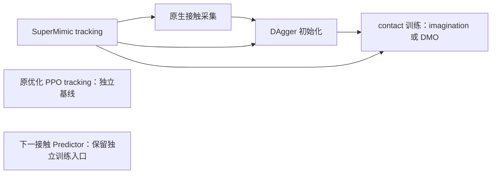

# 当前主流程

`somaforge-unified` 将当前代码放在同一个独立仓库中，使用统一入口选择已有实现。默认主流程是 SuperMimic tracking → 原生接触采集 → DAgger 初始化 → contact 训练。下一接触 Predictor 保留；旧轨迹编辑生成器和 infiller 已退出当前流程。



PPO 只保留原来的 tracking 代码及 recipe，接入 DAgger 的工作暂缓。PPO checkpoint 不能传入下面的 SuperMimic 采集、初始化或 contact 训练接口，也不包含可供这些接口使用的 SuperMimic world model。当前仓库没有 PPO→SuperMimic 权重转换器。

## 入口与运行环境

在仓库根目录运行 `python scripts/run_workflow.py STAGE [入口参数] -- [原生参数]`。`--` 后面的参数原样传给原生程序；入口不修改训练算法、学习率、采样器或 checkpoint。

| Stage | 实现 | 运行环境 |
|---|---|---|
| `tracking`（默认）或 `tracking --backend supermimic` | `supermimic.train` | `supermimic` |
| `tracking --backend ppo` | `scripts/train_php_wbt.py` | `ppo` |
| `collect` | `supermimic.contact_collect` | `supermimic` |
| `initialize` | `supermimic.contact_initialize`，包括原生 DAgger | `supermimic` |
| `contact` | `supermimic.contact_train` | `supermimic` |
| `predictor` | `generator.train_full1000_position` | `ppo` |

`--backend` 只用于 `tracking`。Predictor 使用现有 SomaForge Python 环境，不表示它使用 PPO 训练算法。当前入口逐阶段启动程序，不自动串行启动整条训练链。

运行环境和大文件继续分开管理。`configs/workflow_resources.json` 中分别配置 `supermimic.python`、`supermimic.runtime_root`、可选的 `supermimic.isaaclab_root`，以及 `ppo.python`、`ppo.runtime_root`、可选的 `ppo.isaaclab_root`。相对路径以仓库根目录为基准。runtime 必须解析到仓库外；缓存、临时目录和日志使用各自 runtime。

可用 `--resources PATH` 或 `SOMAFORGE_RESOURCES` 选择资源文件；`--python PATH` 覆盖所选环境的解释器。环境变量 `SOMAFORGE_SUPERMIMIC_PYTHON`、`SOMAFORGE_SUPERMIMIC_RUNTIME`、`SOMAFORGE_SUPERMIMIC_ISAACLAB` 以及对应的 `SOMAFORGE_PPO_*` 也可覆盖配置。入口不安装依赖；解释器缺失时会明确报错。

## 逐阶段检查命令

以下都是 `--dry-run` 模板：只打印命令和环境，不导入模拟器、不创建输出、不启动训练。将 `/external/...` 替换为本机已验证的输入及新的输出目录，检查后移除 `--dry-run` 才会执行。manifest、机器人碰撞 profile、contact response 必须在各阶段一致；示例显式采用 `surface_v2` 和 `manifold_v2`。

第一阶段使用 force6 tracking，保持与后续采集接口的观测约定一致：

```bash
python scripts/run_workflow.py tracking --dry-run -- \
  --task_manifest /external/tasks/task.json \
  --motion_dir /external/tasks/motions \
  --contact_model force6 --collision_profile surface_v2 \
  --contact_response manifold_v2 --log_dir /external/runs/tracking --headless
```

从对应的原生 tracking checkpoint 采集接触轨迹。`--num_envs` 按所用 task manifest 配置；单条采集要求所选 motion 恰好对应一个环境。多动作采集继续使用原生 `--all_motions` / `--selection_manifest` 接口。

```bash
python scripts/run_workflow.py collect --dry-run -- \
  --task_manifest /external/tasks/task.json \
  --checkpoint /external/runs/tracking/ckpt_006000.pt \
  --output /external/runs/recording --motion 0 --num_envs 40 \
  --collision_profile surface_v2 --contact_response manifold_v2 --headless
```

DAgger 使用成功的原生 demonstration 和同一个 tracking teacher。若使用已审核的轨迹切片，显式传入 `--slices /external/cases_validated.pt`，后续 contact 阶段继续使用同一份切片。初始化保留原实现：学生原生 rollout、teacher 查询和 DAgger 更新；world model 来自 SuperMimic tracking checkpoint。

```bash
python scripts/run_workflow.py initialize --dry-run -- \
  --task_manifest /external/tasks/task.json \
  --checkpoint /external/runs/tracking/ckpt_006000.pt \
  --recording /external/runs/recording/rollout.pt \
  --output /external/runs/initialization \
  --collision_profile surface_v2 --contact_response manifold_v2 --headless
```

先完成原生验证并选定可接受的 DAgger checkpoint，再进入 contact 训练。`--checkpoint` 是原 tracking teacher；`--resume` 是本次恢复的 actor/WM 状态；`--prior_checkpoint` 是固定的、已经接受的 DAgger 初始化。三者角色不同，不能按文件扩展名互换。首次训练时后两者可以指向同一个已接受的 `checkpoint_dagger.pt`。

```bash
python scripts/run_workflow.py contact --dry-run -- \
  --task_manifest /external/tasks/task.json \
  --checkpoint /external/runs/tracking/ckpt_006000.pt \
  --recording /external/runs/recording/rollout.pt \
  --resume /external/runs/initialization/checkpoint_dagger.pt \
  --prior_checkpoint /external/runs/initialization/checkpoint_dagger.pt \
  --output /external/runs/contact --policy_gradient dmo \
  --collision_profile surface_v2 --contact_response manifold_v2 --headless
```

`--policy_gradient imagination` 保留原来的 imagination 更新方式；`dmo`、continuous 模式以及其他原生选项均通过 `--` 传递。统一入口没有替代各阶段的原生验证或 checkpoint 接受标准。

## 独立保留的入口

PPO tracking 仍直接调用原优化 recipe `g1_29dof_wbt_baseline_29`，使用原 PHP manifest 校验和原参数设置：

```bash
python scripts/run_workflow.py tracking --backend ppo --dry-run -- \
  --manifest /external/php/motions-locomotion/manifest.json \
  --output-dir /external/runs/ppo-tracking --headless
```

下一接触 Predictor 仍由现有训练程序负责，数据、模型和输出参数通过其原接口指定：

```bash
python scripts/run_workflow.py predictor --dry-run -- --help
```

这里的合并统一了代码位置与启动入口。两套 Python 依赖保持独立，现有数据、模型和验证记录继续保存在外部 runtime；PPO 的下游连接留待后续单独处理。

## 本机合并时的资源状态

2026-10-30 合并时，SuperMimic 的解释器可用；`ppo.python` 指向的原生 SomaForge 环境尚不存在，PPO 和 Predictor 启动前需按安装文档创建环境，或在资源表中指定已准备好的兼容解释器。保留代码不等于已完成该环境的运行验证。

资源表中的 legacy force6 WM 文件存在，但历史 `accepted-baseline.json` 和对应的 `checkpoint_dagger.pt` 未在原路径找到。继续 contact 训练前必须显式提供已经验证的 DAgger checkpoint；统一入口不会替你选择或生成基线。此次合并只进行了 CPU 与静态验证，没有启动新的仿真训练。
