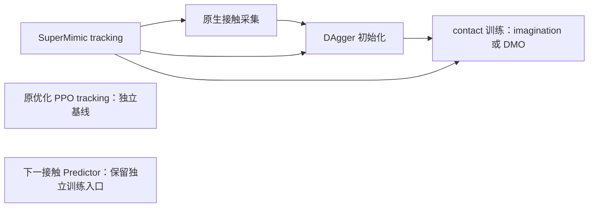

# 当前主流程

`somaforge-unified` 将当前代码放在同一个独立仓库中，使用统一入口选择已有实现。默认主流程是 SuperMimic tracking → 原生接触采集 → DAgger 初始化 → contact 训练。下一接触 Predictor 保留；旧轨迹编辑生成器和 infiller 已退出当前流程。



PPO 只保留原来的 tracking 代码及 recipe，接入 DAgger 的工作暂缓。PPO checkpoint 不能传入下面的 SuperMimic 采集、初始化或 contact 训练接口，也不包含可供这些接口使用的 SuperMimic world model。当前仓库没有 PPO→SuperMimic 权重转换器。

## 已发布的起始模型

[核心 checkpoint 下载与用途](checkpoints.md)提供当前 5k tracking、完整续训状态、contact init/prior 和导航诊断起点。`--checkpoint` 使用 tracking teacher，`--resume` 使用对应 contact 状态，`--prior_checkpoint` 使用固定 prior；完整文件及 SHA256 已发布到 GitHub Release。

## 入口与运行环境

在仓库根目录运行 `python scripts/run_workflow.py STAGE [入口参数] -- [原生参数]`。`--` 后面的参数原样传给原生程序；入口不修改训练算法、学习率、采样器或 checkpoint。

| Stage | 实现 | 运行环境 |
|---|---|---|
| `tracking`（默认）或 `tracking --backend supermimic` | `supermimic.train` | `supermimic` |
| `tracking --backend ppo` | `scripts/train_php_wbt.py` | `ppo` |
| `collect` | `supermimic.contact_collect` | `supermimic` |
| `initialize` | `supermimic.contact_initialize`，包括原生 DAgger | `supermimic` |
| `contact` | `supermimic.contact_train` | `supermimic` |
| `predictor` | `generator.train_full1000_position` | `ppo` |

`--backend` 只用于 `tracking`。Predictor 使用现有 SomaForge Python 环境，不表示它使用 PPO 训练算法。当前入口逐阶段启动程序，不自动串行启动整条训练链。

运行环境和大文件继续分开管理。`configs/workflow_resources.json` 中分别配置 `supermimic.python`、`supermimic.runtime_root`、可选的 `supermimic.isaaclab_root`，以及 `ppo.python`、`ppo.runtime_root`、可选的 `ppo.isaaclab_root`。相对路径以仓库根目录为基准。runtime 必须解析到仓库外；缓存、临时目录和日志使用各自 runtime。

可用 `--resources PATH` 或 `SOMAFORGE_RESOURCES` 选择资源文件；`--python PATH` 覆盖所选环境的解释器。环境变量 `SOMAFORGE_SUPERMIMIC_PYTHON`、`SOMAFORGE_SUPERMIMIC_RUNTIME`、`SOMAFORGE_SUPERMIMIC_ISAACLAB` 以及对应的 `SOMAFORGE_PPO_*` 也可覆盖配置。入口不安装依赖；解释器缺失时会明确报错。

## 逐阶段检查命令

以下都是 `--dry-run` 模板：只打印命令和环境，不导入模拟器、不创建输出、不启动训练。将 `/external/...` 替换为本机已验证的输入及新的输出目录，检查后移除 `--dry-run` 才会执行。manifest、机器人碰撞 profile、contact response 必须在各阶段一致；示例显式采用 `surface_v2` 和 `manifold_v3`。

第一阶段使用 force6 tracking，保持与后续采集接口的观测约定一致：

```bash
python scripts/run_workflow.py tracking --dry-run -- \
  --task_manifest /external/tasks/task.json \
  --motion_dir /external/tasks/motions \
  --contact_model force6 --collision_profile surface_v2 \
  --contact_response manifold_v3 --log_dir /external/runs/tracking --headless
```

从对应的原生 tracking checkpoint 采集接触轨迹。`--num_envs` 按所用 task manifest 配置；单条采集要求所选 motion 恰好对应一个环境。多动作采集继续使用原生 `--all_motions` / `--selection_manifest` 接口。

```bash
python scripts/run_workflow.py collect --dry-run -- \
  --task_manifest /external/tasks/task.json \
  --checkpoint /external/runs/tracking/ckpt_006000.pt \
  --output /external/runs/recording --motion 0 --num_envs 40 \
  --collision_profile surface_v2 --contact_response manifold_v3 --headless
```

DAgger 使用成功的原生 demonstration 和同一个 tracking teacher。若使用已审核的轨迹切片，显式传入 `--slices /external/cases_validated.pt`，后续 contact 阶段继续使用同一份切片。初始化保留原实现：学生原生 rollout、teacher 查询和 DAgger 更新；world model 来自 SuperMimic tracking checkpoint。

```bash
python scripts/run_workflow.py initialize --dry-run -- \
  --task_manifest /external/tasks/task.json \
  --checkpoint /external/runs/tracking/ckpt_006000.pt \
  --recording /external/runs/recording/rollout.pt \
  --output /external/runs/initialization \
  --collision_profile surface_v2 --contact_response manifold_v3 --headless
```

先完成原生验证并选定可接受的 DAgger checkpoint，再进入 contact 训练。`--checkpoint` 是原 tracking teacher；`--resume` 是本次恢复的 actor/WM 状态；`--prior_checkpoint` 是固定的、已经接受的 DAgger 初始化。三者角色不同，不能按文件扩展名互换。首次训练时后两者可以指向同一个已接受的 `checkpoint_dagger.pt`。

```bash
python scripts/run_workflow.py contact --dry-run -- \
  --task_manifest /external/tasks/task.json \
  --checkpoint /external/runs/tracking/ckpt_006000.pt \
  --recording /external/runs/recording/rollout.pt \
  --resume /external/runs/initialization/checkpoint_dagger.pt \
  --prior_checkpoint /external/runs/initialization/checkpoint_dagger.pt \
  --output /external/runs/contact --policy_gradient dmo \
  --collision_profile surface_v2 --contact_response manifold_v3 --headless
```

`--policy_gradient imagination` 保留原来的 imagination 更新方式；`dmo`、continuous 模式以及其他原生选项均通过 `--` 传递。统一入口没有替代各阶段的原生验证或 checkpoint 接受标准。

## 独立保留的入口

PPO tracking 仍直接调用原优化 recipe `g1_29dof_wbt_baseline_29`，使用原 PHP manifest 校验和原参数设置：

```bash
python scripts/run_workflow.py tracking --backend ppo --dry-run -- \
  --manifest /external/php/motions-locomotion/manifest.json \
  --output-dir /external/runs/ppo-tracking --headless
```

下一接触 Predictor 仍由现有训练程序负责，数据、模型和输出参数通过其原接口指定：

```bash
python scripts/run_workflow.py predictor --dry-run -- --help
```

这里的合并统一了代码位置与启动入口。两套 Python 依赖保持独立，现有数据、模型和验证记录继续保存在外部 runtime；PPO 的下游连接留待后续单独处理。

## 本机运行环境与启动验证

本机已建立 `runtime/environments/venv/workflow`，通过 system-site-packages 复用现有 SuperMimic 仿真环境，在独立 venv 中补齐 wandb、CLI 和网页测试依赖。`supermimic.python` 与 `ppo.python` 均明确指向该解释器，原训练环境未修改。重建命令：

```bash
python3 scripts/setup_workflow_environment.py
```

基础解释器由资源表中的 `supermimic.base_python` 指定，也可用 `--base-python PATH` 覆盖。补充包精确版本位于 `configs/environments/workflow-extras.lock.txt`，源码包以 editable 方式安装。这个环境沿用 SuperMimic 当前的 Newton/Warp 组合；`profiles.json` 中原生 `main` 的完整版本锁仍是另一套可复现安装方案，不能将两者版本号混称。

`tracking` 和 `initialize` 原生参数支持 `--startup_check`：在真实物理初始化及策略前向后退出，不执行优化器更新、不写训练 checkpoint。contact 的 `--profile_collection --freeze_actor --freeze_wm` 用于冻结采集检查，会验证 actor 和 WM 的 state_dict 完全不变。检查细节见 [启动验证](startup-validation.md)。

历史 `accepted-baseline.json` 和其原 `checkpoint_dagger.pt` 仍缺失。已有其他历史 DAgger/contact 文件只用作兼容性启动样例，不自动成为已接受的新训练基线；正式 contact 训练前仍需明确选定经过验证的 checkpoint。

旧仓库已归档清理。当前源码只在 `somaforge-unified`，独立 IsaacLab 位于 `/home/zhouxia/workspace/dependencies/IsaacLab`；旧项目名仅保留外部资源兼容链接，以支持历史 manifest/checkpoint 的绝对路径。归档位置见 `configs/consolidation_provenance.json`，运行数据与权重未迁移或删除。

### 原始 PHP 接触数据

新切分只接受拼接前的原始数据库片段，入口要求
`source_unit=original_database_clip`。`motions-*` 组合轨迹和历史 PHP296
采集保留作历史记录，不再重复切分。镜像保留并标明同源增强。
原始库位于 `runtime/supermimic/data/php_originals_v1/`；打包的来源策略在
`packages/supermimic/supermimic/resources/experiments/contact_data_source.json`。
这些数据仍是运动学来源，需要转换到权威机器人并采集当前物理接触后再切分。

恢复下载工具（已存在的数据会校验并复用）：

```bash
runtime/environments/venv/workflow/bin/python packages/supermimic/tools/prepare_php_originals.py --download-only
```

新 tracking 默认 `manifold_v3`，其他阶段显式选择相同版本。旧版本仍保留用于
兼容历史 checkpoint，不会把旧采集或权重自动标成 v3。迁移验证不等于重新训练。
